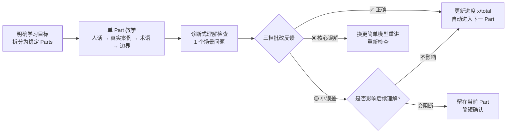
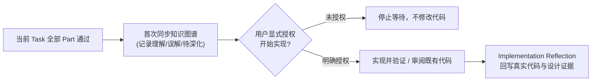

# 🎓 Learning Coach Skill

**面向初学者的渐进式教学 Agent Skill：把 AI 从“直接给答案”改成“检查理解后再推进”。**

[](skills/learning-coach/SKILL.md)
[](skills/learning-coach/references/teaching-protocol.md)
[](skills/learning-coach/agents/openai.yaml)

初学者用 AI 学习技术时，最常见的失控不是“信息太少”，而是**进度快于理解**：AI 一次性抛出大量术语、长段代码和完整答案，用户看完觉得“好像懂了”，真正追问概念边界时却一头雾水。

`learning-coach` 用一套可复用的交互协议约束 AI 教学行为：**一次只讲透一个核心概念，先批改理解再推进进度，并在项目驱动学习中严格隔离“学完”与“改代码”。**

---

## 核心机制



### 1. 稳定进度与单 Part 7 步讲解协议

每次教学都会先锁定稳定的 Part 列表，并在每轮显式展示当前进度：

```text
当前 Part：2. 关系型数据库中的事务（Transaction）
学习进度：1/5
```

每个 Part 严格按 [teaching-protocol.md](skills/learning-coach/references/teaching-protocol.md) 的 7 步顺序展开：
1. **先讲人话**：不用未解释术语，一句话说清它做什么；
2. **映射到真实上下文**：优先结合用户当前项目的真实代码、数据或页面；
3. **讲清为什么需要它**：说清不采用会出什么问题；
4. **引入正式术语**：以 `中文解释（English Term）` 引入，避免术语堆叠；
5. **最小真实材料**：先读后引，通常只截取 3–8 行真实代码并逐行解释；
6. **划清深度边界**：明确区分 `现在必须理解` 与 `现在不用理解`；
7. **理解检查**：提出 1 个诊断性场景问题（禁止问“你懂了吗？”）。

### 2. 三档批改与推进规则

| 批改结果 | 判定标准 | 推进策略 |
| --- | --- | --- |
| **✅ 正确** | 抓住核心用途、能区分相近概念、能放回当前上下文 | 确认要点、更新 `x/total`，**无需用户说“继续”直接进入下一 Part** |
| **🟡 基本正确，有一处需修正** | 方向正确但存在局部偏差、遗漏或易混淆表述 | 不影响后续则纠正后推进；会阻断后续理解则留在当前 Part 做简短确认 |
| **❌ 尚未完全理解** | 出现核心概念混淆或职责颠倒 | 进度不变，换更简单的心智模型重讲并重新检查 |

### 3. 项目驱动开发中的 Learning Gate（学习与实现分离）

当用户通过真实代码项目学习（且项目存在 `LEARNING_MAP.md` 或知识图谱）时，Skill 会强制启用双阶段同步与授权闸门：



> **核心原则**：通过理解检查只代表“完成本轮学习”，不等于“永久掌握”，更**不等于授权修改代码**。

---

## 业务理解与状态数据流

AI 教学产品的核心业务难点在于防止**“虚假掌握（Illusion of Competence）”**和**“进度口径失真”**——如果系统仅凭对话轮数或用户一句“懂了”就推进，学习状态数据就失去了参考价值。本项目用严格的状态流转来约束教学数据：

| 状态数据环节 | 数据口径与约束 | 解决的业务问题 |
| --- | --- | --- |
| **Part 进度分母** | 会话启动时锁定 Part 列表；追问、澄清、重试均不增加分母 | 避免进度条漂移，让 `passed/total` 真正反映知识覆盖率 |
| **作答诊断证据** | 每次状态转移必须基于用户的实际回答，按 3 档标准判定 | 用可检验的理解证据替代“你懂了吗？”式主观确认 |
| **知识图谱双同步** | 首次同步只写用户实际展现的理解与误解（标为 `已完成本轮学习`）；实现后再回写真实代码与测试证据 | 区分“听懂概念”与“工程掌握”，保持 `LEARNING_MAP.md` 按知识树组织而非流水账 |
| **授权隔离闸门** | 学习达标状态与代码修改权限完全解耦 | 防止 AI 越权改代码，保障学习节奏由用户主导 |

---

## 快速使用

### 安装方式

将 `skills/learning-coach/` 目录复制到你的 Agent / Codex Skills 目录（例如 `~/.codex/skills/learning-coach`），或直接在对话中要求 Agent 先阅读 `skills/learning-coach/SKILL.md`。

### 调用示例

```text
$learning-coach 带我从头学习数据库事务
```

```text
$learning-coach 结合当前项目的存储模块，带我理解 SQLite 迁移和外键约束
```

```text
$learning-coach 考考我昨天学过的前端构建和 Tauri 桌面端区别
```

---

## 仓库结构

```text
learning-coach-skill/
├── README.md
└── skills/
    └── learning-coach/
        ├── SKILL.md                        # 主 Skill 定义：触发边界、会话流程、Learning Gate 与输出自检
        ├── agents/
        │   └── openai.yaml                 # Agent UI 展示名称、默认提示与隐式调用策略
        └── references/
            └── teaching-protocol.md        # 7 步讲解协议、3 档批改模板与项目学习双同步规范
```

---

## 设计取舍与当前边界

- **只约束教学交互，不替代外部评测**：本仓库是纯 Skill / 协议资产（Markdown + YAML），不含独立 Web 服务，也尚未进行大规模真实学习者的对照效果测试；
- **严格区分触发边界**：仅在用户明确表达学习、复习或测验意图时激活，不强行拦截普通的开发/修改任务。
